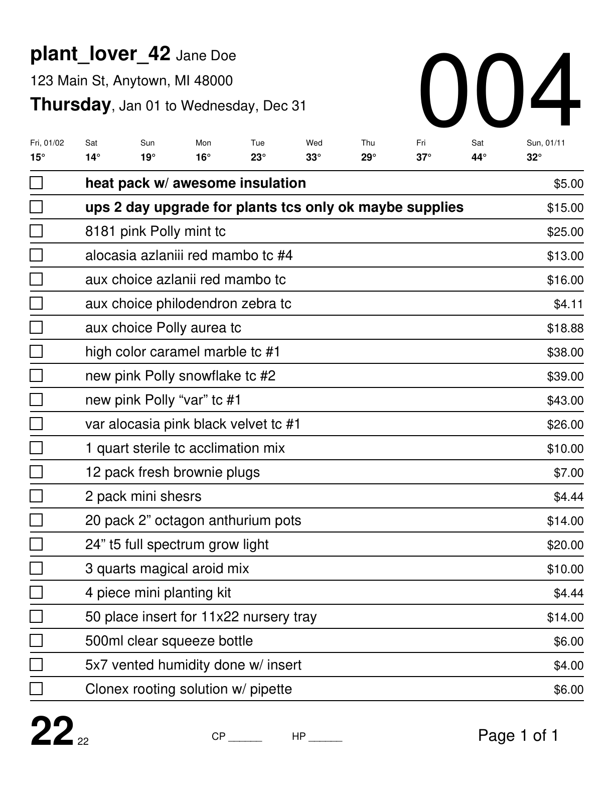

# monday

Order fulfillment for a live-selling plant business. `monday` turns a show's order export (Excel) into a printable, packing-ready PDF: one pick sheet per customer, plus summary reports for the whole shipment.



## What it does

- **Pick sheets per customer.** Items are grouped by customer and address, with checkboxes for packing, prices and a large order ID to match each box to its sheet.
- **Weather-aware packing.** Each sheet shows the 10-day forecast at the destination (Mapbox geocoding + Open-Meteo) and flags extreme temperatures, so packers know when to add a heat pack.
- **Shipping estimates.** UPS and USPS APIs estimate transit time for each customer. Orders are sorted by it, and customer-paid shipping is estimated from configurable rates.
- **Multi-show merging.** Pass up to three exports. Customers keep the same order ID across shows. Items bought after fulfillment has started print on supplemental sheets linked by that ID, so nothing already packed has to be redone.
- **Reports.** Order summary (total quantity per item), plant list, customer summary, hold-until-date orders and conflict detection (e.g. one customer with mismatched addresses).
- **Giveaways.** `giveaway.py` reconciles giveaway and donation items in an export.

## Setup

Requires Python 3.10+.

```bash
pip install reportlab openpyxl requests python-dotenv geopy python-dateutil
```

Create a `.env` file for the shipping APIs:

```bash
UPS_CLIENT_ID=...
UPS_CLIENT_SECRET=...
USPS_CLIENT_ID=...
USPS_CLIENT_SECRET=...
```

Shipping rates, temperature thresholds, fonts and the origin ZIP code live in `config.py`.

## Usage

```bash
python convert.py
```

This opens a small desktop app. Choose one export to generate sheets for a single show, or two to three exports to merge shows and print supplemental sheets for late additions. The PDF is saved as `<Weekday>_<MM-DD-YY>.pdf`.

To build a standalone macOS app:

```bash
pyinstaller --onefile --windowed --name=ConvertApp convert.py
```

## Project layout

| File | Purpose |
| --- | --- |
| `convert.py` | GUI and processing pipeline (single, two- and three-file modes) |
| `order_utils.py` | Excel parsing, grouping by customer, sorting, aggregation |
| `generate_pages.py` | PDF layout for pick sheets and reports (ReportLab) |
| `est_transit_times.py` | UPS and USPS transit-time clients (OAuth2) |
| `weather.py` | Geocoding and forecast lookup |
| `predicates.py` | Item classification (plants, supplies, holds, shipping upgrades) |
| `giveaway.py` | Giveaway and donation reconciliation |
| `config.py` | Rates, thresholds and layout settings |

Order exports contain customer data, so `*.xlsx`, `*.csv` and `.env` are git-ignored.